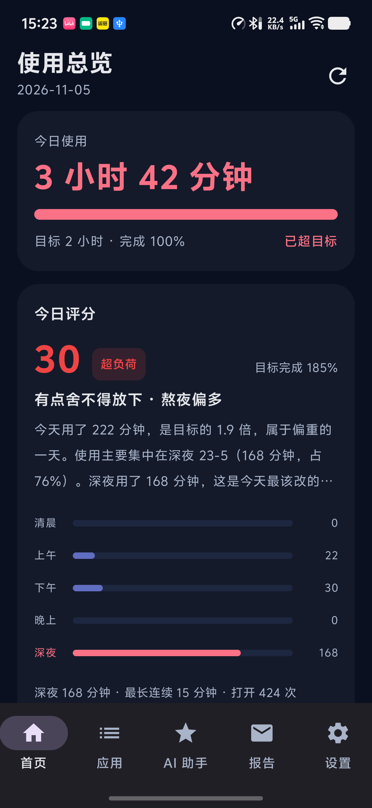
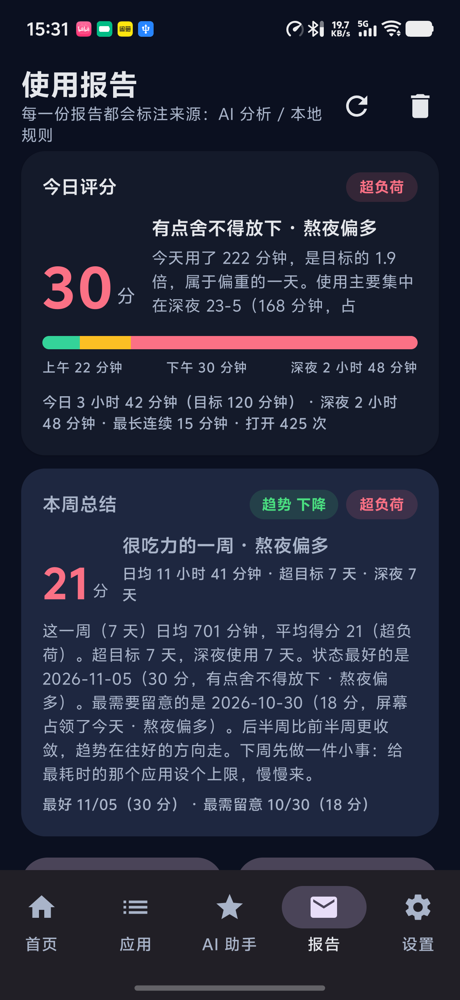
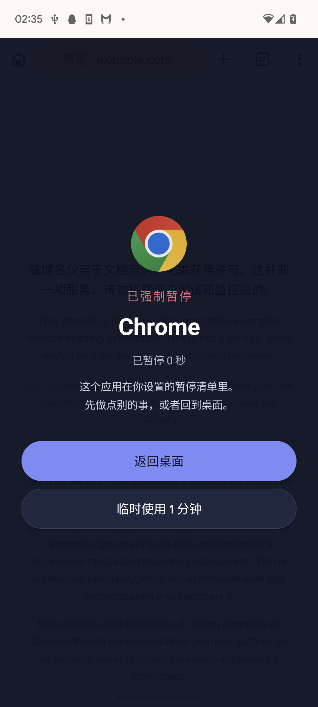
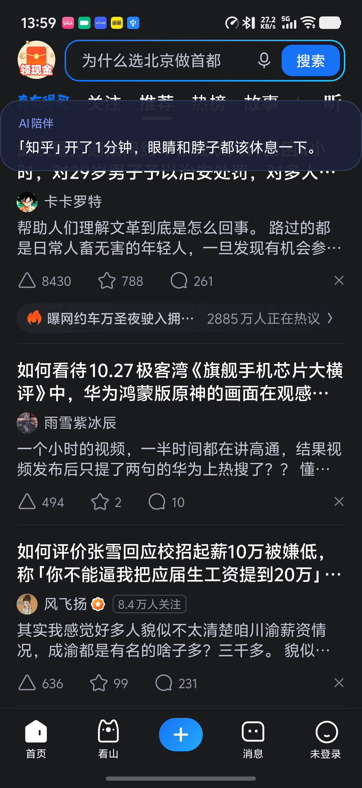
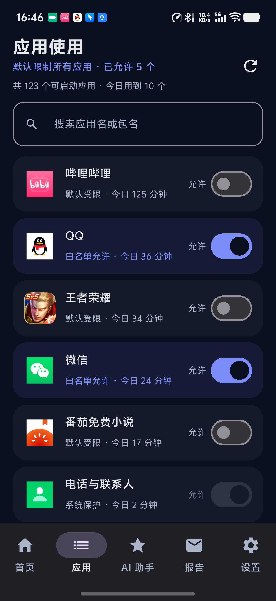
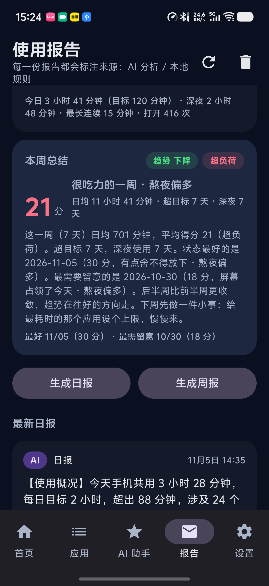
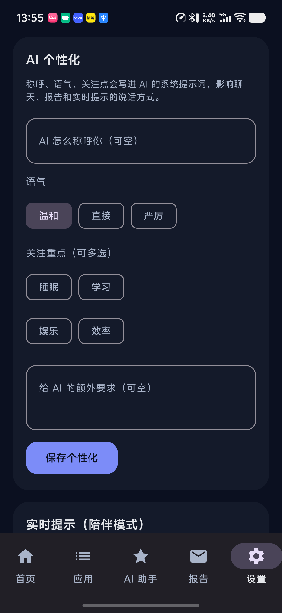
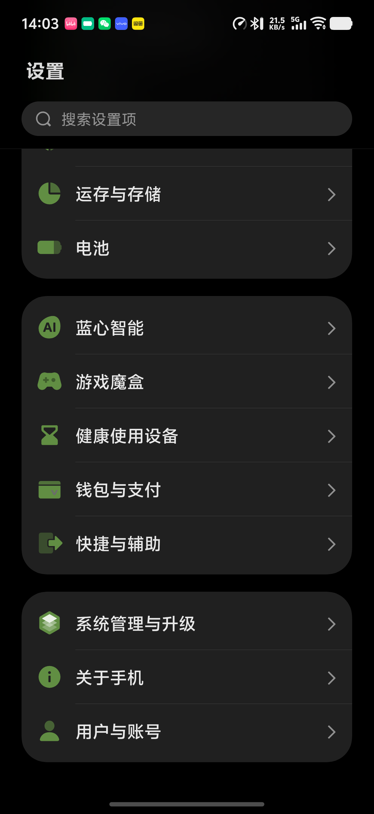

# AI 使用管家（AI Usage Guard）

一个运行在 Android 手机上的「AI 数字健康 / 使用管家」：本地统计各 App 使用时长、按需强制暂停、
用 LLM Agent 分析并生成日报周报，并提供**用自然语言调控整个 App**的能力。

> 无 root、纯本地数据（Room + DataStore），AI 仅在你配置 API Key 后调用。

## 功能一览

| 模块 | 能力 |
|---|---|
| 使用统计 | `UsageStatsManager` + `UsageEvents` 采集前台会话，Room 落库；今日/7 天/单 App 详情/排行榜 |
| 强制暂停 | 无障碍服务 + 无障碍浮层，打开被限制应用即拦截；「返回桌面」/「临时使用 1 分钟」（每 App 每天 1 次） |
| 限制模型 | **默认限制第三方应用** + 白名单（始终允许）；电话/短信/设置/桌面/输入法/所有系统应用永久豁免 |
| 行为分析 | 6 类检测：使用增加、长会话、深夜使用、频繁启动、超总目标、连续多日增长 |
| AI Agent | 26 个工具：查数据、查评分、白名单增删、**改设置**（目标/勿扰/通知/主题/限制模式/实时提示/个性化）、限制/放行应用、刷新数据、生成报告、发测试通知 |
| AI 个性化 | 称呼、语气（温和/直接/严厉）、关注点（睡眠/学习/娱乐/效率）、自定义要求，注入系统提示词 |
| 实时提示 | 连续使用同一 App 达阈值时，屏幕顶部弹一句提示（本地模板或 AI 生成），可配置间隔 5–30 分钟 |
| 今日评分 | 100 分制：超出目标 / 深夜使用 / 超长连续 / 高频解锁扣分，克制加成；5 档等级 + 个性化判断词条 |
| 每日 / 每周总结 | 首页与报告页的评分卡、本周总结卡；本地规则报告与 AI 报告均带分数与词条；通知首行带分数 |
| 后台任务 | WorkManager：30 分钟同步、60 分钟分析、22:30 日报、周日周报；四类通知渠道 |

## 截图

| 首页（今日评分） | 报告页（评分 + 本周总结） |
|---|---|
|  |  |

| 拦截浮层 | 实时提示（陪伴模式） |
|---|---|
|  |  |

| 应用列表（默认限制 + 白名单） | AI 助手（分数解读） |
|---|---|
|  |  |

| 权限 / 设置 | 系统应用豁免 |
|---|---|
|  |  |

## 技术栈

- Kotlin 2.2.10 / Jetpack Compose（Material3）/ 单 Activity + 5 Tab，宽度 ≥600dp 用 NavigationRail
- Room 2.7.1（KSP，schema 导出）/ DataStore Preferences
- WorkManager 2.9.1 / OkHttp 4.12 / kotlinx-coroutines
- AGP 8.13.2 / Gradle 8.13 / JDK 17 / compileSdk 36 / targetSdk 35 / minSdk 26
- MVVM + Repository；`data/Container.kt` 极简依赖容器（无 DI 框架）

## 架构

```
app/src/main/java/com/aid/usageguard/
├── data/            # Room 实体/DAO、UsageEventSource、UsageIngester、Repository、设置、容器
├── domain/          # 模型、行为分析引擎、评分引擎（UsageScoreEngine）、本地报告生成
├── agent/           # LLM 客户端（OpenAI / Anthropic）、26 个工具、ToolExecutor、AgentLoop、对话记忆
├── service/         # GuardService（无障碍 + 拦截浮层 + 实时提示）
├── restriction/     # 限制策略、RuleValidator（系统应用保护）、TempAllowStore
├── work/            # 4 个 Worker + 排期
├── notify/          # 通知渠道与文案
└── ui/              # Compose 页面：首页 / 应用 / AI 助手 / 报告 / 设置 + 主题、Markdown-lite
```

关键设计：

- **AI 不能执行任意代码**：模型只能调用白名单内的 26 个本地工具，工具内部再校验参数与系统保护应用。
- **评分是本地确定性算法**（不依赖 AI），AI 只负责解读与建议，离线可用。
- **系统应用豁免**：默认限制只作用于用户安装的第三方应用，避免 OEM ROM 的系统组件被拦。

## 构建与运行

1. 用 Android Studio 打开本仓库（或命令行 Gradle 8.13）：

```bash
gradle :app:assembleDebug     # APK: app/build/outputs/apk/debug/app-debug.apk
```

2. 安装到手机：

```bash
adb install -r -t app/build/outputs/apk/debug/app-debug.apk
```

3. 授权（三项必需，均无需 root）：

```bash
adb shell appops set com.aid.usageguard GET_USAGE_STATS allow               # 使用情况访问
adb shell pm grant com.aid.usageguard android.permission.POST_NOTIFICATIONS # 通知（Android 13+）
adb shell settings put secure enabled_accessibility_services \
  com.aid.usageguard/com.aid.usageguard.service.GuardService                # 无障碍
adb shell settings put secure accessibility_enabled 1
```

4. 也可以打开 App 后按「设置 → 权限状态」的引导逐项授权。

5. 配置 AI（可选）：设置 → AI 接口，填 BaseURL（默认 `https://api.deepseek.com`）、API Key、
   模型（如 `deepseek-chat`）、协议（OpenAI 兼容 / Anthropic）。Key 只保存在本机 DataStore。

## 使用要点

- **默认限制第三方应用**：除白名单与系统应用外，打开即拦；在「应用」页把开关打开 = 加入白名单。
- **临时使用**：拦截页「临时使用 1 分钟」，每个 App 每天仅一次。
- **AI 助手**：直接说自然语言，例如「把每日目标改成 2 小时」「限制哔哩哔哩」「我今天多少分」
  「关闭通知」「现在生成周报」。修改类工具只在明确要求时执行。
- **实时提示**：连续使用同一应用达 15 分钟（可调 5/10/15/30）时顶部弹一句，8 秒自动消失。

## 评分与词条规则

| 维度 | 扣分上限 |
|---|---|
| 超出每日目标 | −45（目标 2 倍即扣满） |
| 深夜使用 23:00–05:00 | −20 |
| 单次超长连续使用 | −15 |
| 高频解锁 | −12 |
| 克制加成 | 低于目标 50% +3、无深夜 +3 |

等级：`≥90 优秀 / ≥75 良好 / ≥60 一般 / ≥40 偏多 / <40 超负荷`。
判断词条由「时长档位（6）× 深夜档位（4）× 时段分布 × 语气 × 称呼」组合生成；
时段分 5 段：清晨 5-9 / 上午 9-12 / 下午 12-18 / 晚上 18-23 / 深夜 23-5。

## 隐私与安全

- 使用数据、设置、AI Key 全部保存在本机（Room / DataStore），不上传服务器；AI 请求只发送聚合统计。
- 无障碍服务仅用于检测前台应用并在越界时展示提示浮层，不读取屏幕内容。
- 系统关键应用（电话/短信/设置/桌面/输入法/预装应用）不可被限制，避免把手机锁死。
- AI 工具调用有白名单、参数校验、超时与次数上限；不提供 Shell / 任意 Intent 能力。

## 版本演进

| 版本 | 内容 |
|---|---|
| v1.0 | 使用统计、限制/拦截、行为分析、AI 日报周报、通知、WorkManager、5 页 UI |
| v1.1 | 设置页 AI 配置、报告页、无障碍拦截稳定性、通知权限处理 |
| v1.2 | 默认限制 + 白名单、临时使用每日一次、Markdown 渲染、输入法豁免 |
| v1.3 | AI 调控白名单、实时提示（陪伴模式）、AI 个性化选项 |
| v1.4 | OEM 系统应用豁免（Android 16 / vivo 适配）、无 root 部署验证 |
| v1.5 | AI 可完整调控 App（控制类工具）、批量设置、AI 生成即时报告 |
| v1.6 | 今日评分、时段判断词条、每日/每周总结、`daily_score` 表与历史趋势 |

详细实现说明见 [IMPLEMENTATION.md](IMPLEMENTATION.md)，各版本真机验收报告见 [docs/reports/](docs/reports/)，
需求原文见 [docs/spec.md](docs/spec.md)。

## 辅助脚本（scripts/）

| 脚本 | 用途 |
|---|---|
| `ug_setup_device.sh` | 安装 + 授予使用情况/通知/无障碍 + 注入 AI 配置（`UG_API_KEY`、`UG_BASE_URL` 通过环境变量传入） |
| `ug_ui.py` | adb UI 自动化：dump / tap / 文本输入 / 截图（`UG_SERIAL` 指定设备） |
| `ug_chat.py` | 在 AI 助手页发送一条消息并等待回复（真机联调） |
| `ug_read_prefs.py` | 读取并解码 DataStore 设置（`run-as`，无需 root） |

## 已知限制

- 拦截依赖无障碍服务；服务被系统杀死或手动关闭后需重新开启。
- 评分依赖本地会话记录的完整性；某天未记录到数据时按 0 分钟计。
- AI 报告质量取决于所配置模型；未配置 Key 时自动降级为本地规则报告。
- 未针对平板/折叠屏做专门适配（使用自适应网格与 NavigationRail，基本可用）。

## 目录

```
app/                Android 应用模块（Kotlin + Compose）
scripts/            adb 辅助脚本
docs/screenshots/   界面截图
docs/reports/       各版本真机验收报告
docs/spec.md        需求规格
IMPLEMENTATION.md   实现说明与验收映射
```
